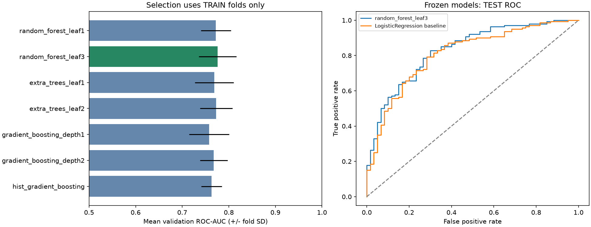
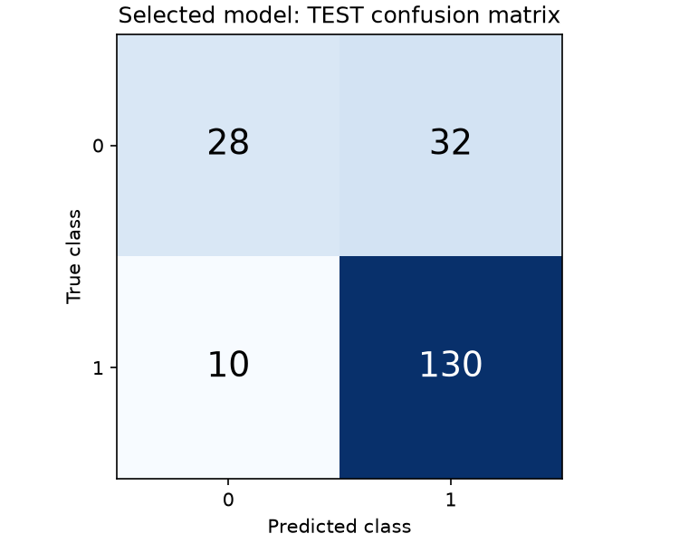

# Лабораторная №4. Ансамбли

## Данные и подготовка

Используется german.csv: 1000 строк и 20 признаков. Целевая переменная — Creditability, первый столбец. Разделитель — `;`. Пропусков: 0, дубликатов строк: 0.

Данные разделены в отношении 80/20 с сохранением долей классов, random_state=42. На обучение приходится 800 строк, на тест — 200. Численность классов [0, 1]: train — [240, 560], test — [60, 140]. Разбиение такое же, как в третьей работе.

Используются все признаки, категориальные коды оставлены числовыми. Масштабирование для деревьев не применяется. В pipeline добавлен SimpleImputer: медианы вычисляются только на обучающих данных; полностью пустой столбец заполняется нулём. В данном CSV заполнять пропуски не понадобилось.

Параметры сравниваются на train с помощью StratifiedKFold: 5 частей, shuffle=True, random_state=42. В каждом запуске 640 строк используются для обучения и 160 — для проверки. Лучшая конфигурация выбирается по средней ROC-AUC, затем обучается на всех 800 строках. Тестовая выборка используется только для итоговой оценки.

## Гипотезы и эксперименты

Сравниваются Random Forest, Extra Trees, Gradient Boosting и HistGradientBoosting — всего семь конфигураций. У лесов меняется минимальный размер листа, у Gradient Boosting — глубина дерева. Предположение: ограничение сложности уменьшит переобучение, а более глубокие деревья бустинга смогут учесть взаимодействия признаков.

- `random_forest_leaf1`: `{"n_estimators": 250, "min_samples_leaf": 1, "max_features": "sqrt"}`.
- `random_forest_leaf3`: `{"n_estimators": 250, "min_samples_leaf": 3, "max_features": "sqrt"}`.
- `extra_trees_leaf1`: `{"n_estimators": 300, "min_samples_leaf": 1, "max_features": "sqrt"}`.
- `extra_trees_leaf2`: `{"n_estimators": 300, "min_samples_leaf": 2, "max_features": "sqrt"}`.
- `gradient_boosting_depth1`: `{"n_estimators": 150, "learning_rate": 0.05, "max_depth": 1}`.
- `gradient_boosting_depth2`: `{"n_estimators": 150, "learning_rate": 0.05, "max_depth": 2}`.
- `hist_gradient_boosting`: `{"max_iter": 150, "learning_rate": 0.05, "max_leaf_nodes": 15, "l2_regularization": 2.0, "early_stopping": false}`.

Остальные параметры оставлены стандартными. Seed — 42, n_jobs=1; вычисления BLAS/OpenMP также ограничены одним потоком. Веса классов не меняются, early stopping у HistGradientBoosting отключён. Время обучения и оценки всех моделей без построения графиков: 4.45 с.

- Random Forest: leaf=1 → leaf=3 изменил CV AUC с 0.772340 до 0.776042; проверялось сглаживание листьев для снижения переобучения.
- Extra Trees: leaf=1 → leaf=2 изменил CV AUC с 0.768917 до 0.772879; проверялось сочетание случайных порогов и сглаживания.
- Gradient Boosting: depth=1 → depth=2 изменил CV AUC с 0.757924 до 0.767764; проверялась польза парных взаимодействий признаков.
- HistGradientBoosting с 15 листьями и L2=2 получил CV AUC 0.762946; проверялась регуляризованная гистограммная модель с ограниченной сложностью.

## Метрики

Средние результаты пятикратной кросс-валидации на train. Критерий выбора — ROC-AUC.

| Конфигурация | ROC-AUC | Accuracy | Precision | Recall | F1 |
|---|---:|---:|---:|---:|---:|
| random_forest_leaf1 | 0.772340 | 0.756250 | 0.777412 | 0.914286 | 0.839739 |
| random_forest_leaf3 | 0.776042 | 0.750000 | 0.769822 | 0.917857 | 0.836587 |
| extra_trees_leaf1 | 0.768917 | 0.763750 | 0.784723 | 0.912500 | 0.843394 |
| extra_trees_leaf2 | 0.772879 | 0.760000 | 0.777261 | 0.921429 | 0.842726 |
| gradient_boosting_depth1 | 0.757924 | 0.727500 | 0.744695 | 0.932143 | 0.827384 |
| gradient_boosting_depth2 | 0.767764 | 0.756250 | 0.777281 | 0.914286 | 0.839994 |
| hist_gradient_boosting | 0.762946 | 0.751250 | 0.797601 | 0.864286 | 0.829181 |

Результаты на test. Эта таблица рассчитана после выбора модели и на выбор не влияет. Для сравнения добавлена готовая логистическая регрессия из третьей работы.

| Конфигурация | ROC-AUC | Accuracy | Precision | Recall | F1 |
|---|---:|---:|---:|---:|---:|
| random_forest_leaf1 | 0.825119 | 0.795000 | 0.811321 | 0.921429 | 0.862876 |
| random_forest_leaf3 | 0.829881 | 0.790000 | 0.802469 | 0.928571 | 0.860927 |
| extra_trees_leaf1 | 0.816786 | 0.760000 | 0.787500 | 0.900000 | 0.840000 |
| extra_trees_leaf2 | 0.821190 | 0.780000 | 0.796296 | 0.921429 | 0.854305 |
| gradient_boosting_depth1 | 0.808988 | 0.775000 | 0.777778 | 0.950000 | 0.855305 |
| gradient_boosting_depth2 | 0.822500 | 0.775000 | 0.798742 | 0.907143 | 0.849498 |
| hist_gradient_boosting | 0.817500 | 0.790000 | 0.826667 | 0.885714 | 0.855172 |
| LogisticRegression (baseline №3) | 0.808571 | 0.770000 | 0.801282 | 0.892857 | 0.844595 |

ROC-AUC считается по вероятностям класса 1. Для остальных метрик порог равен 0.5: при равенстве выбирается класс 1. Положительный класс — Creditability=1. Порог заранее фиксирован; для Precision, Recall и F1 задан zero_division=0.





## Выбранная модель

Лучший результат на кросс-валидации показал **RandomForestClassifier (random_forest_leaf3)**: средняя ROC-AUC — **0.776042**, стандартное отклонение — 0.040388. Поэтому для функции run_ensemble_experiment выбран этот вариант: 250 деревьев, min_samples_leaf=3, max_features="sqrt".

На test получены ROC-AUC = **0.829881**, Accuracy = **0.790000**, Precision = 0.802469, Recall = 0.928571, F1 = 0.860927.

Лес обучает деревья на bootstrap-выборках и использует случайные подмножества признаков при разбиении. Итоговая вероятность усредняется по деревьям. Минимум три объекта в листе ограничивает слишком мелкие разбиения; в этом опыте это улучшило среднюю ROC-AUC по сравнению с листом из одного объекта.

## Выводы и ограничения

Выбранный лес превысил результат логистической регрессии на test: разница ROC-AUC составила +0.021310, Accuracy — +0.020000. Разбиение у моделей одинаковое; масштабирование для логистической регрессии обучено только на train.

Увеличение размера листа улучшило результаты обоих лесов. У Gradient Boosting глубина 2 дала более высокую ROC-AUC на кросс-валидации, чем глубина 1, но не обошла выбранный Random Forest. Сам по себе переход к более сложной модели лучшего результата не дал.

Вывод относится к одному разбиению небольшого датасета. Классы несбалансированы, поэтому одной Accuracy недостаточно. Категории закодированы числами, хотя между ними не всегда есть порядок; можно отдельно проверить one-hot кодирование. Высокий Recall класса 1 не означает такого же качества для класса 0 — ошибки видны на матрице. Доверительные интервалы и калибровка вероятностей в этой работе не рассчитывались.

## Воспроизводимость

Python 3.12.14, numpy 2.5.4, pandas 3.1.1, scikit-learn 1.9.1. Версии библиотек закреплены в requirements.txt. Python 3.12+ для указанного окружения.

```bash
python -m pip install -r requirements.txt
python run_experiments.py
python -m unittest discover -v
```

Для просмотра графиков: `python run_experiments.py --show`. При запуске тестов графики также открываются; нужно закрыть окна, чтобы тесты завершились. Запуск без окон: `MPLBACKEND=Agg python -m unittest discover -v`.

Скрипт сохраняет REPORT.md, experiment_results.json и два графика. В JSON записаны параметры, оценки кросс-валидации, метрики и прогнозы на test. Тесты сверяют метрики с допуском 1e-6. Время выполнения при повторном запуске может отличаться.
